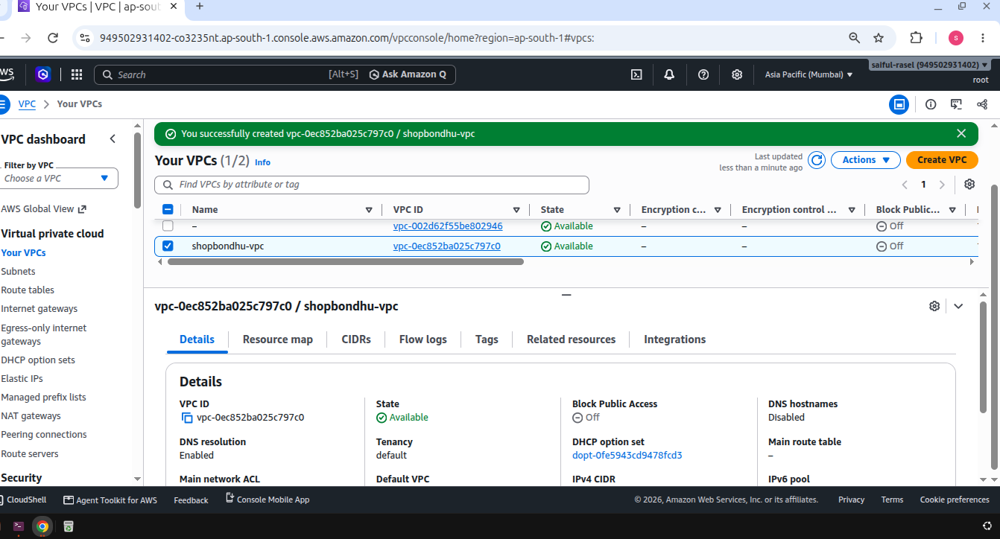
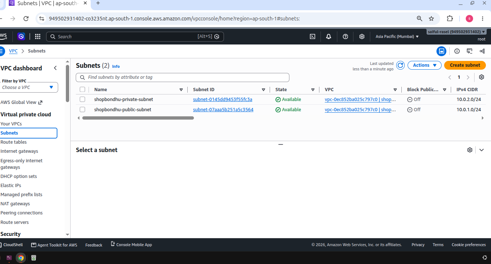
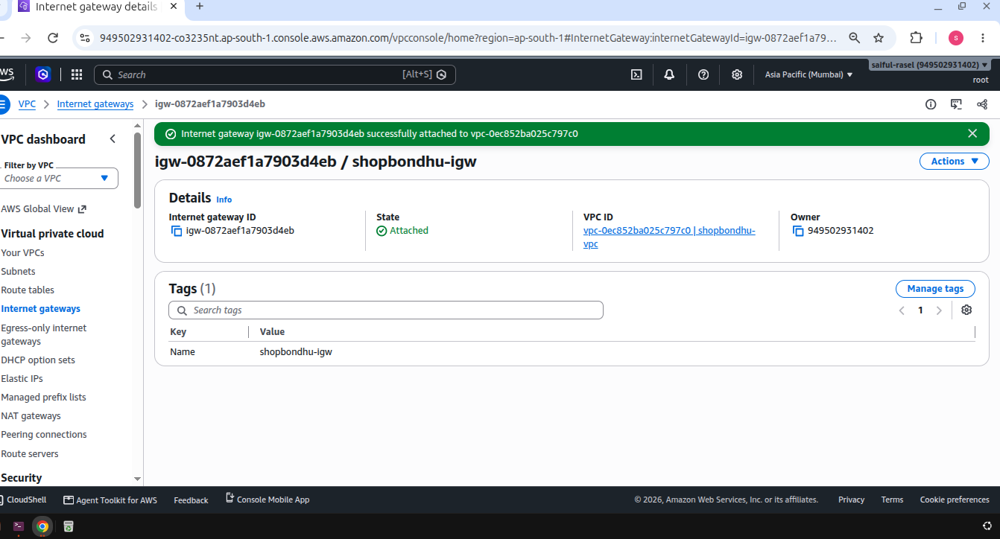
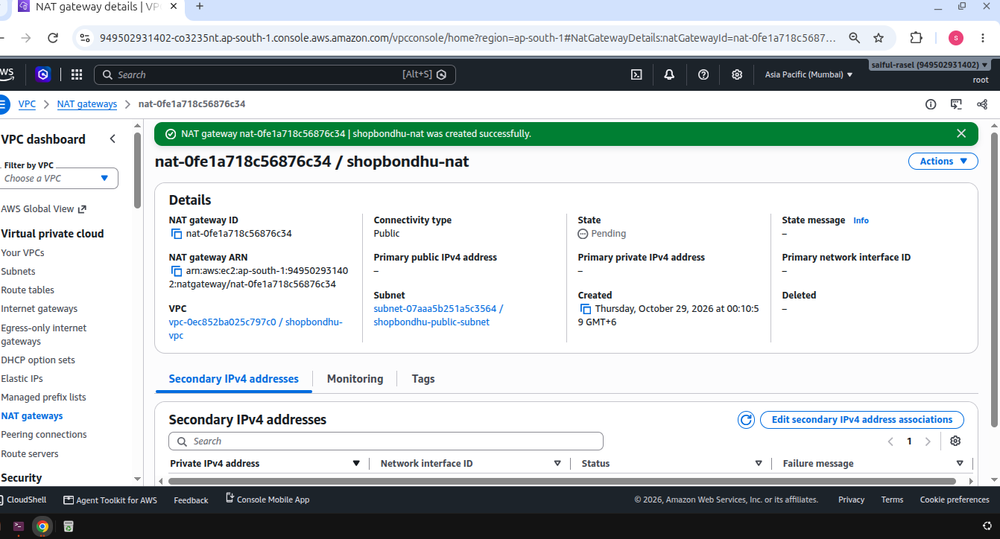
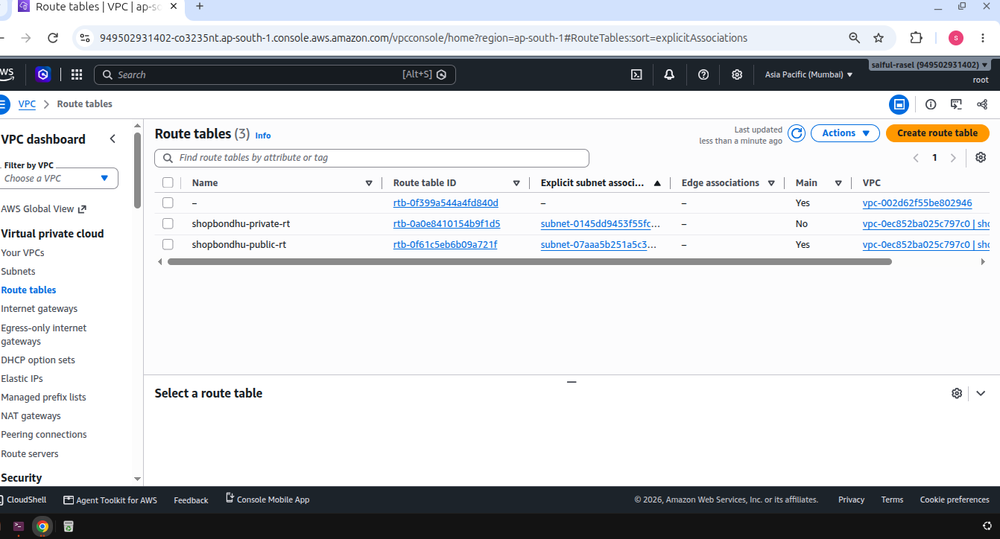
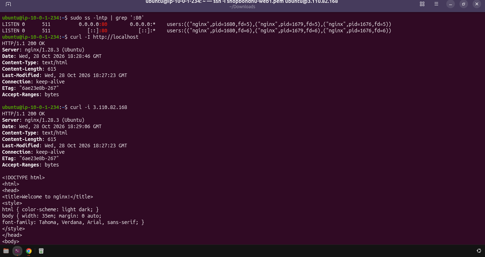
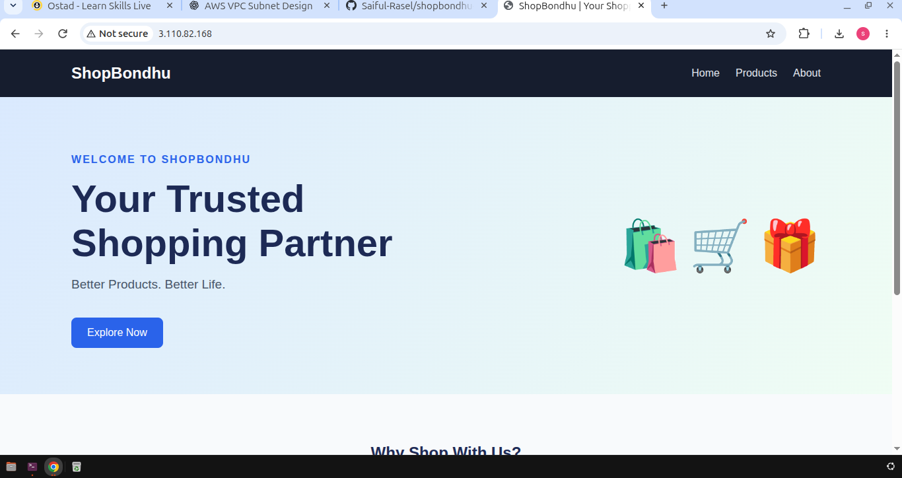
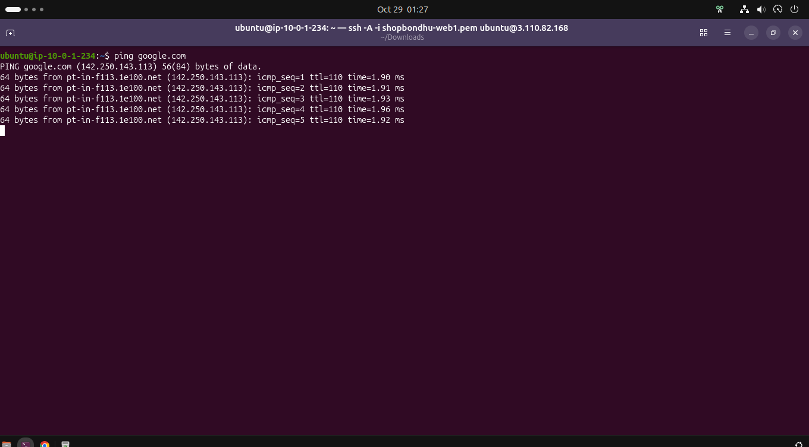

# ShopBondhu AWS Assignment

## 1. Project Title & Description

**ShopBondhu** is a static e-commerce landing page deployed on an AWS EC2 instance using Nginx.

The project demonstrates how to build a custom AWS network with public and private subnets, configure internet connectivity, deploy a static website, and verify outbound internet access from a private EC2 instance through a NAT Gateway.

### Project Objectives

- Create a custom VPC with public and private subnets.
- Configure an Internet Gateway (IGW) and a NAT Gateway.
- Configure public and private route tables.
- Launch public and private EC2 instances.
- Restrict access using security groups.
- Deploy a static frontend using Nginx.
- Verify outbound internet connectivity from the private instance.
- Document troubleshooting and resource cleanup.

## 2. Architecture Diagram

```text
                         Internet Users
                               |
                               v
                    Internet Gateway (IGW)
                               |
              +--------------------------------+
              |          shopbondhu-vpc         |
              |          10.0.0.0/16            |
              |                                 |
              |       Public Subnet             |
              |       10.0.1.0/24                |
              |                                 |
              |    +----------------------+     |
              |    | shopbondhu-web       |     |
              |    | Ubuntu + Nginx        |     |
              |    | HTTP :80              |     |
              |    +----------------------+     |
              |               |                 |
              |               | SSH :22         |
              |               v                 |
              |       Private Subnet            |
              |       10.0.2.0/24                |
              |                                 |
              |    +----------------------+     |
              |    | shopbondhu-backend   |     |
              |    | Ubuntu               |     |
              |    | Private IPv4 only    |     |
              |    +----------------------+     |
              |               |                 |
              |               v                 |
              |          NAT Gateway            |
              |          Elastic IP             |
              +---------------|-----------------+
                              |
                              v
                           Internet
```

### Architecture Explanation

- **VPC:** Provides an isolated network for the project.
- **Public subnet:** Hosts the web server and supports public HTTP access.
- **Private subnet:** Hosts the backend EC2 instance without a public IPv4 address.
- **Internet Gateway:** Provides an internet route for eligible public-subnet resources.
- **NAT Gateway:** Allows private instances to initiate outbound internet connections.
- **Route tables:** Define where network traffic is sent.
- **Security groups:** Control inbound and outbound traffic to EC2 instances.

The web server acts as a jump host for SSH access to the private backend.

## 3. AWS Resources

Update the placeholders with the actual values from your AWS account.

| Resource | Name | CIDR / ID | Purpose |
|---|---|---|---|
| VPC | `shopbondhu-vpc` | `10.0.0.0/16` | Isolated project network |
| Public Subnet | `shopbondhu-public-subnet` | `10.0.1.0/24` | Public web server |
| Private Subnet | `shopbondhu-private-subnet` | `10.0.2.0/24` | Private backend server |
| Internet Gateway | `shopbondhu-igw` | `[Actual IGW ID]` | Internet connectivity |
| NAT Gateway | `shopbondhu-nat` | `[Actual NAT ID]` | Private outbound connectivity |
| Elastic IP | `[Actual Elastic IP]` | `[Allocation ID]` | NAT Gateway public address |
| Public Route Table | `shopbondhu-public-rt` | `[Actual Route Table ID]` | Route to IGW |
| Private Route Table | `shopbondhu-private-rt` | `[Actual Route Table ID]` | Route to NAT Gateway |
| Web EC2 | `shopbondhu-web` | `[Actual public/private IPs]` | Nginx web server |
| Backend EC2 | `shopbondhu-backend` | `[Actual private IP]` | Private Ubuntu server |
| Web Security Group | `[Actual SG name]` | `[Actual SG ID]` | Web server access rules |
| Backend Security Group | `[Actual SG name]` | `[Actual SG ID]` | Private server access rules |

## 4. Step-by-Step Implementation

### Task 1: Create the VPC

Created a custom VPC named `shopbondhu-vpc` with IPv4 CIDR `10.0.0.0/16`.

This VPC provides the network boundary for the project's public and private subnets.



### Task 2: Create Public and Private Subnets

Created two subnets inside the custom VPC:

- Public subnet: `shopbondhu-public-subnet` — `10.0.1.0/24`
- Private subnet: `shopbondhu-private-subnet` — `10.0.2.0/24`

Configured automatic public IPv4 assignment for the public subnet and disabled it for the private subnet.



### Task 3: Create and Attach the Internet Gateway

Created an Internet Gateway named `shopbondhu-igw` and attached it to `shopbondhu-vpc`.

An Internet Gateway alone does not make a subnet public. The route table, public IPv4 addressing, and security rules must also be configured correctly.



### Task 4: Create the NAT Gateway

Created `shopbondhu-nat` in the public subnet and associated an Elastic IP with it.

The NAT Gateway allows instances in the private subnet to initiate outbound IPv4 connections without requiring public IPv4 addresses on those instances.



### Task 5: Configure Route Tables

#### Public Route Table

Created `shopbondhu-public-rt` and associated it with the public subnet.

Required routes:

| Destination | Target |
|---|---|
| `10.0.0.0/16` | Local |
| `0.0.0.0/0` | Internet Gateway |

The default route must point to the actual IGW associated with the VPC.



#### Private Route Table

Created `shopbondhu-private-rt` and associated it with the private subnet.

Required routes:

| Destination | Target |
|---|---|
| `10.0.0.0/16` | Local |
| `0.0.0.0/0` | NAT Gateway |

The default route must point to the actual NAT Gateway.


**Verification:** Confirm that both route tables have the correct routes and subnet associations.

### Task 6: Launch EC2 Instances and Configure Security Groups

Launched two Ubuntu EC2 instances:

1. `shopbondhu-web` in the public subnet.
2. `shopbondhu-backend` in the private subnet.

#### Web Server Security Group

Recommended inbound rules:

| Protocol | Port | Source | Purpose |
|---|---:|---|---|
| TCP | 22 | My trusted public IP `/32` | SSH administration |
| TCP | 80 | `0.0.0.0/0` | Public HTTP access |

#### Backend Security Group

Recommended inbound rule:

| Protocol | Port | Source | Purpose |
|---|---:|---|---|
| TCP | 22 | Web server security group | SSH from the jump host |

Outbound rules must permit the required traffic. Network ACLs must also allow the required traffic and return traffic.





**Security note:** Do not expose SSH to `0.0.0.0/0`. For improved security, consider AWS Systems Manager Session Manager where supported and configured.

### Task 7: Install and Configure Nginx

Connected to the public web server using SSH and installed Nginx.

Commands executed on the web server:

```bash
# Update the package index.
sudo apt update

# Install Nginx.
sudo apt install -y nginx

# Start Nginx and enable it at boot.
sudo systemctl enable --now nginx

# Check service status.
sudo systemctl status nginx --no-pager

# Verify that Nginx is listening on port 80.
sudo ss -lntp | grep ':80'

# Validate the Nginx configuration.
sudo nginx -t

# Test the local HTTP endpoint.
curl -I http://localhost/
```

Opened the web server's public IPv4 address in a browser to verify the default Nginx page.



### Task 8: Deploy the Frontend

The static frontend consists of HTML, CSS, and JavaScript files.

Expected local project structure:

```text
shopbondhu-aws-assignment/
├── README.md
├── commands.md
├── frontend/
│   ├── index.html
│   ├── css/
│   └── js/
└── screenshots/
```

Run the following commands from the local development machine. Replace the placeholder with the actual public IPv4 address of the web server.

```bash
# Create a temporary deployment directory.
ssh ubuntu@<WEB_PUBLIC_IP> \
  'mkdir -p /tmp/shopbondhu-frontend'

# Copy the frontend files to the web server.
scp -r frontend/. \
  ubuntu@<WEB_PUBLIC_IP>:/tmp/shopbondhu-frontend/
```

Commands executed on the web server:

```bash
# Deploy the static files into the Nginx document root.
sudo cp -r /tmp/shopbondhu-frontend/. /var/www/html/

# Validate the Nginx configuration.
sudo nginx -t

# Reload Nginx.
sudo systemctl reload nginx

# Verify the deployed homepage.
curl -I http://localhost/
```

The deployed website should be available at:

`http://<WEB_PUBLIC_IP>`

Replace `<WEB_PUBLIC_IP>` with the actual public IPv4 address.

**Deployment verification:** Confirm that the browser displays the ShopBondhu landing page rather than the default Nginx welcome page.


### Task 9: Test Private Server Connectivity and NAT Gateway

Connected to the public web server first:

```bash
ssh ubuntu@<WEB_PUBLIC_IP>
```

From the web server, connect to the backend using its private IP:

```bash
ssh ubuntu@<BACKEND_PRIVATE_IP>
```

Replace both placeholders with the actual addresses.

On the backend server, execute:

```bash
# Check the routing table.
ip route

# Verify DNS resolution.
getent hosts google.com

# Update package indexes through the NAT Gateway.
sudo apt update

# Test outbound HTTPS connectivity.
curl -I --max-time 15 https://google.com
```

Successful package updates and an HTTP response from the HTTPS request demonstrate outbound internet connectivity, provided the traffic is routed through the NAT Gateway as configured.


#### Why Is the Backend Not Directly Reachable from the Internet?

The backend instance has no public IPv4 address, and its security group allows SSH only from the web server's security group.

The private route table sends internet-bound IPv4 traffic to the NAT Gateway. The NAT Gateway allows outbound connections initiated by the private instance and their corresponding response traffic.

It does not provide unsolicited inbound internet access to the backend.

The public web server can act as a jump host because it can reach the backend's private IP and is allowed by the backend security group.

## 5. Nginx and Frontend Deployment Summary

Nginx serves the static website files from `/var/www/html`.

The deployment process includes:

1. Installing Nginx.
2. Starting and enabling the service.
3. Copying frontend files to the web server.
4. Validating the Nginx configuration.
5. Reloading Nginx.
6. Testing the local HTTP endpoint.
7. Verifying the public website in a browser.

The final browser screenshot should show the ShopBondhu landing page and the public IP in the address bar.


## 6. NAT Gateway Test Results

The NAT Gateway test checks whether the private backend can access external package repositories and websites without a public IP address.

Commands tested on the backend:

```bash
sudo apt update
curl -I --max-time 15 https://google.com
```

**Actual result:** [Record whether both commands succeeded and include the relevant output.]

**Verification checklist:**

- [ ] Backend has no public IPv4 address.
- [ ] Private route table has `0.0.0.0/0` pointing to the NAT Gateway.
- [ ] NAT Gateway is in the `Available` state.
- [ ] NAT Gateway has an associated Elastic IP.
- [ ] `sudo apt update` completes successfully.
- [ ] `curl` receives an HTTP response.

**Conclusion:** A successful test, together with verification of the route table and NAT Gateway, demonstrates outbound internet connectivity from the private subnet.


## 7. Troubleshooting

### Problem A: The Website Does Not Open, but SSH Works

#### Reason 1: HTTP Port 80 Is Blocked

The web server's security group may not allow inbound HTTP traffic.

**Check:**

- Open the AWS EC2 console.
- Select the web server's security group.
- Inspect the inbound rules.
- Confirm that TCP port 80 is allowed from `0.0.0.0/0` if the site is intended to be public.

#### Reason 2: Nginx Is Not Running

Check the service and logs:

```bash
sudo systemctl status nginx --no-pager
sudo journalctl -u nginx -n 50 --no-pager
```

Validate the configuration and start Nginx:

```bash
sudo nginx -t
sudo systemctl enable --now nginx
```

If the configuration test fails, fix the reported error before reloading Nginx.

#### Reason 3: Nginx Is Not Listening on Port 80

Check the listening socket:

```bash
sudo ss -lntp | grep ':80'
```

Test the local endpoint:

```bash
curl -I http://localhost/
```

If the local request succeeds but external access fails, inspect the public IP, security groups, route tables, and network ACLs.

#### Reason 4: Incorrect Public IP or Routing

Verify that:

- The EC2 instance has the expected public IPv4 address.
- The Internet Gateway is attached to the correct VPC.
- The public subnet's route table contains `0.0.0.0/0` pointing to the IGW.
- The security group and network ACL rules permit the traffic.

### Problem B: `sudo apt update` Hangs or Times Out on the Backend

#### Reason 1: NAT Gateway Is Not Available

Inspect the NAT Gateway state in the VPC console. It must be `Available` and located in the public subnet.

#### Reason 2: Elastic IP Is Not Associated

Verify that the NAT Gateway has an Elastic IP associated with it.

#### Reason 3: Incorrect Private Route Table

Confirm that the private subnet is associated with the intended route table and that it contains:

```text
0.0.0.0/0 -> NAT Gateway
```

#### Reason 4: Public Subnet Cannot Reach the Internet

Confirm that the public route table contains:

```text
0.0.0.0/0 -> Internet Gateway
```

Also verify that the IGW is attached to the correct VPC and that the NAT Gateway is in a public subnet.

#### Reason 5: DNS or Outbound Traffic Is Blocked

Run the following commands on the backend:

```bash
# Inspect routes.
ip route

# Check DNS resolution.
getent hosts google.com

# Test HTTPS connectivity.
curl -I --max-time 15 https://google.com
```

If DNS resolution fails, investigate the VPC DNS settings and resolver configuration. If DNS succeeds but the HTTPS request times out, inspect NAT Gateway status, routes, security group egress rules, network ACLs, and the destination's availability.

## 8. Cleanup

After collecting the required assignment evidence, remove resources that are no longer needed.

### Cleanup Checklist

- [ ] Delete the NAT Gateway and verify that its state becomes `Deleted`.
- [ ] Release the Elastic IP after it is no longer associated with the NAT Gateway.
- [ ] Terminate EC2 instances that are no longer required.
- [ ] Remove dependent VPC resources when appropriate.
- [ ] Delete the custom VPC after dependent resources have been removed, if the lab is being retired.
- [ ] Verify the final resource states in the AWS console.

### Cleanup 
**Why is cleanup important?**

NAT Gateways can incur hourly and data-processing charges while they exist. Public IPv4 addresses can also incur charges depending on their allocation and usage.

Removing unused billable resources helps prevent unnecessary AWS costs.

**Important:** Update this section only after cleanup has actually been completed. Do not claim that resources have been deleted if they are still running.

## 9. What I Learned

- I learned how to create a custom VPC and configure public and private subnets.
- I learned how Internet Gateways, NAT Gateways, and route tables control network connectivity.
- I learned how to launch EC2 instances and restrict access using security groups.
- I learned how to install Nginx and deploy a static website on Ubuntu.
- I learned how to verify outbound internet connectivity from a private subnet.
- I learned how to troubleshoot routing, DNS, HTTP, and SSH connectivity issues.
- I learned why resource cleanup is important for AWS cost management.

## 10. Project Verification

Before submitting the assignment, verify the following:

- [ ] All required screenshots exist in the `screenshots/` directory.
- [ ] Screenshot filenames match the Markdown references in this README.
- [ ] The ShopBondhu website loads from the web server's public IP.
- [ ] Nginx is running and serving the deployed frontend.
- [ ] The backend does not have a public IPv4 address.
- [ ] The backend can reach the internet through the NAT Gateway.
- [ ] AWS resource IDs and IP addresses have been filled in where required.
- [ ] Actual test results have been recorded.
- [ ] Cleanup evidence reflects the real resource state.


